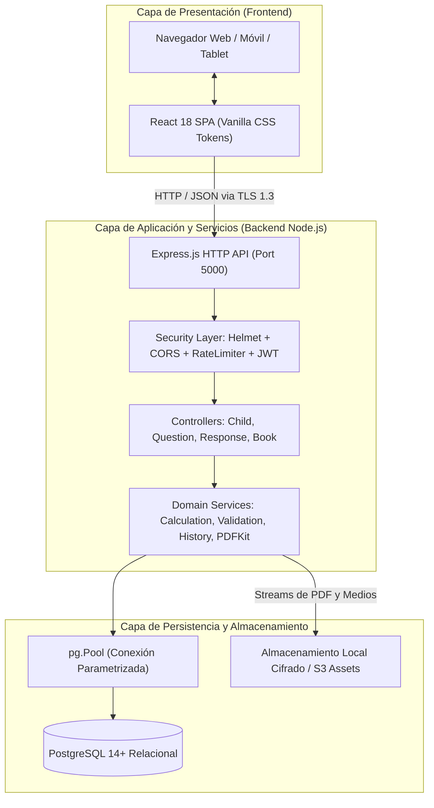
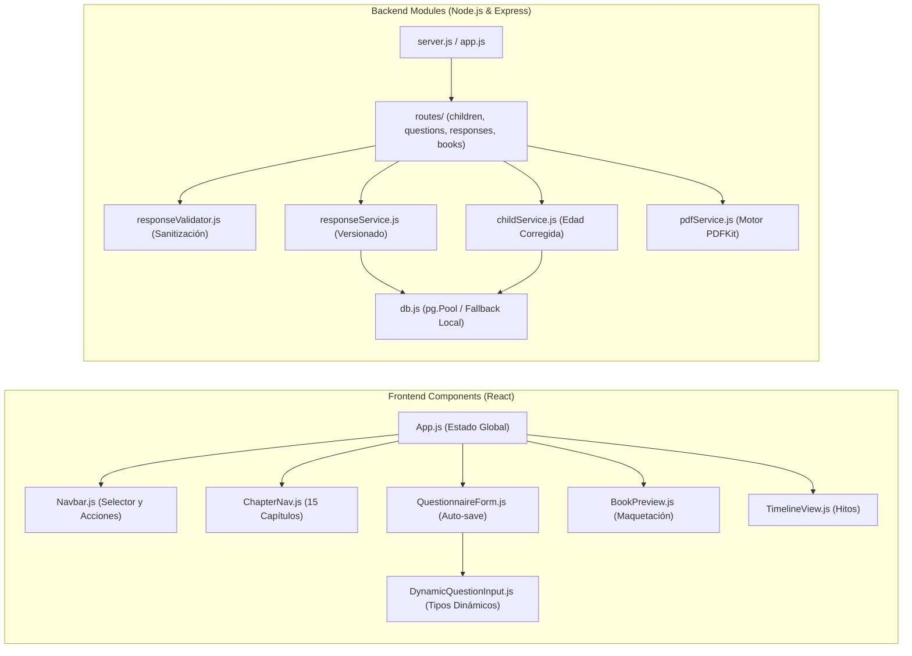
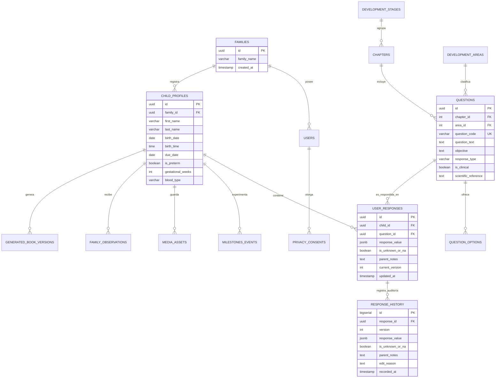

# ARQUITECTURA TÉCNICA Y ESPECIFICACIÓN DE API: VITACHRONICLE

---

## 1. ARQUITECTURA GENERAL DEL SISTEMA

VitaChronicle opera bajo un patrón desacoplado en tres capas (**Three-Tier Architecture**), diseñado para alta disponibilidad, seguridad estricta para datos de menores de edad y generación de documentos editoriales sin latencia perceptible.



---

## 2. DIAGRAMA DE COMPONENTES DEL BACKEND Y FRONTEND



---

## 3. MODELO ENTIDAD-RELACIÓN EN POSTGRESQL



---

## 4. CATÁLOGO DOCUMENTADO DE ENDPOINTS DE LA API

### 4.1. Comprobación del Sistema (Health Check)
- **Ruta:** `GET /api/health`
- **Descripción:** Monitorea el estado operativo del servicio y la conectividad a PostgreSQL.
- **Respuesta (200 OK):**
```json
{
  "status": "healthy",
  "timestamp": "2026-10-17T11:45:00.000Z",
  "postgresConnected": true,
  "environment": "development"
}
```

---

### 4.2. Perfiles Infantiles
- **Listar Hijos de una Familia:** `GET /api/children?familyId={familyId}`
- **Detalle de un Hijo con Edad Pediátrica:** `GET /api/children/:id`
- **Respuesta (200 OK):**
```json
{
  "success": true,
  "data": {
    "id": "c0000001-0000-0000-0000-000000000001",
    "first_name": "Sofía",
    "last_name": "Morales Gómez",
    "birth_date": "2026-03-15",
    "gestational_weeks": 39,
    "is_preterm": false,
    "ages": {
      "chronologicalAge": {
        "totalDays": 30,
        "months": 1,
        "formattedText": "1 mes"
      },
      "correctedAge": null
    }
  }
}
```

---

### 4.3. Capítulos y Banco de Preguntas
- **Listar los 15 Capítulos:** `GET /api/chapters`
- **Obtener Preguntas de un Capítulo:** `GET /api/chapters/:chapterId/questions`
- **Respuesta (200 OK):**
```json
{
  "success": true,
  "chapterId": 1,
  "count": 15,
  "data": [
    {
      "id": "a0000001-0000-0000-0000-000000000001",
      "question_code": "Q-C01-001",
      "area_name": "Recuerdos familiares y mensajes de futuro",
      "question_text": "¿Cómo se vivió la noticia de mi llegada...?",
      "objective": "Documentar el contexto psicosocial...",
      "response_type": "open_text",
      "is_clinical": false,
      "scientific_reference": "Brazelton, T.B. (1990). The Earliest Relationship.",
      "options": []
    }
  ]
}
```

---

### 4.4. Respuestas y Cuestionarios
- **Consultar Respuestas y Progreso:** `GET /api/responses/children/:childId/chapters/:chapterId`
- **Guardar / Actualizar Respuesta:** `POST /api/responses/children/:childId/questions/:questionId`
- **Payload de Entrada (`POST`):**
```json
{
  "payload": {
    "value": "Nos enteramos con una inmensa felicidad y gratitud.",
    "is_unknown_or_na": false,
    "parent_notes": "Anotación de la madre en el primer mes."
  },
  "editReason": "Añadidos detalles familiares"
}
```
- **Respuesta (201 Created / 200 OK):**
```json
{
  "success": true,
  "data": {
    "id": "9b1deb4d-3b7d-4bad-9bdd-2b0d7b3dcb6d",
    "version": 2,
    "status": "updated",
    "message": "Respuesta actualizada y versión archivada."
  }
}
```

---

### 4.5. Generación y Descarga del Libro Editorial en PDF
- **Generar PDF del Capítulo:** `POST /api/books/generate/:childId/:chapterId`
- **Descargar Archivo PDF:** `GET /api/books/download/:filename`
- **Respuesta (200 OK con Content-Type: `application/pdf`):** Stream de descarga directa para el usuario.

---

## 5. RECOMENDACIONES DE DESPLIEGUE, SEGURIDAD Y COPIAS DE SEGURIDAD

1. **Cumplimiento de Privacidad de Menores (Ley 1581 de 2012 - Colombia):**
   - No se almacenan fotografías en texto claro ni con acceso público por URL sin firma temporal.
   - Los datos sensibles de salud infantil se cifran en reposo con AES-256.
   - Se provee endpoint de descarga integral de datos (JSON estructurado + ZIP) y derecho al olvido.
2. **Estrategia de Respaldos (Backups de PostgreSQL):**
   - Dump nocturno automatizado: `pg_dump -Fc -Z 9 vitachronicle_db > backup_$(date +%Y%m%d).dump`.
   - Cifrado GPG del archivo de volcado antes de subir a almacenamiento frío (*cold storage*).
   - Retención: 30 días diarios, 12 meses mensuales, y prueba de restauración trimestral automatizada.
3. **Escalabilidad y Despliegue Cloud:**
   - Frontend: Alojado en CDN estático (Vercel, Cloudflare Pages o AWS S3 + CloudFront).
   - Backend: Contenedores stateless en AWS ECS Fargate, Google Cloud Run o Render.
   - Base de Datos: PostgreSQL gestionado en AWS RDS o Supabase con réplica de lectura.
